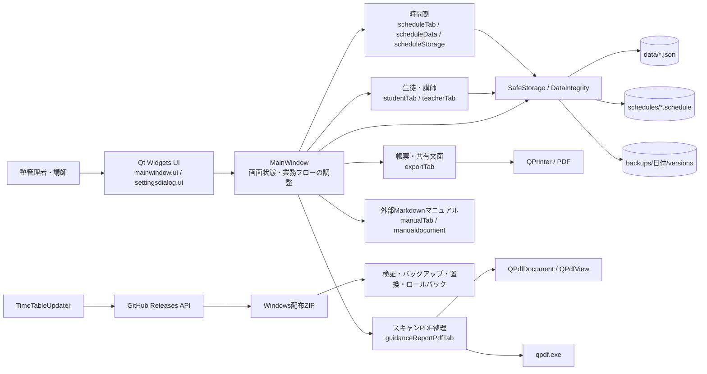

# TimeTable 開発実績レポート

- 調査日：2026年10月9日
- 対象：`ROMEKANA/TimeTable`（ローカル `master`、`10cb897b5f29ef0d7378802acc7e541d08eacfbf`）
- 現行ソースのバージョン：`0.3.32`
- 用途：2028年卒業予定者の自己PR、ガクチカ、ES、ポートフォリオ、技術面接の基礎資料

## 0. この資料の読み方と調査範囲

本資料は、採用向けに機能を誇張せず、確認できた事実と未確認事項を分離してまとめたものである。

### 証拠区分

- **確認済み（コード）**：現行ソースに実装があり、処理内容を読解できたもの。
- **確認済み（自動検証）**：今回の調査でDebugビルドまたはCTestが成功したもの。
- **確認済み（履歴）**：Gitコミットまたは過去のCodex作業記録で経緯を確認できたもの。
- **未確認（手動操作）**：実画面、エクスプローラー、プリンター、実PDF、GitHub更新など、今回操作していないもの。
- **本人への確認事項**：動機、本人とAIの分担、実利用、作業時間など、資料だけでは確定できないもの。

### 今回確認した資料

- 調査開始時点でGit管理中だった全31ファイル（C++、ヘッダー、Qt Designer UI、CMake、PowerShell、Batch、Markdownなど）
- `README.md`、`AGENTS.md`、`CMakeLists.txt`、`defaults/manual.md`
- Gitの全198コミット、タグ、差分統計、著者名義、主要コミットの変更内容
- 現行の公開GitHubリポジトリ、ブランチ、タグ、Release、Issue一覧
- 過去のCodex作業記録の要約。特にデータ保全、バックアップ復元、破損時間割復旧、外部Markdownマニュアル、予定文面設定、リポジトリレビューを確認した
- 現行DebugビルドとCTest

### 取得できなかった、または網羅していない情報

- 過去のCodex会話本文を全件・全メッセージ単位では確認していない。アクセス可能な作業記録の要約と、関連性の高いセッション記録を使用した。
- 実際の総作業時間、1日あたりの作業時間、AIが生成したコードの正確な割合は取得できない。
- `TimeTable.exe` の実画面操作、実プリンター、実データ、実際のPDF送付、別PCでの配布物起動は今回確認していない。
- GitHubのコミット著者名義だけでは、人間が直接書いたコードとAIが生成したコードを区別できない。
- 実利用者数、利用期間、削減できた作業時間、利用者の評価は資料から確認できない。

## 1. プロジェクト概要

### 基本情報

|項目|内容|根拠|
|---|---|---|
|プロジェクト名|TimeTable（ウィンドウ表示名は「塾時間割表」）|`CMakeLists.txt:3`、`mainwindow.cpp:137`|
|種別|Windows向けQtデスクトップアプリ|`README.md:5-11`、`main.cpp:13-17`|
|開発目的|塾の時間割、生徒・講師、予定表、給与明細、指導報告書を一つのアプリで管理・印刷する|`README.md:1-3`|
|想定利用者|塾の管理者・講師|`defaults/manual.md` の「管理者向け」「講師向け」|
|現行バージョン|0.3.32|`CMakeLists.txt:3`|
|公開先|[GitHub: ROMEKANA/TimeTable](https://github.com/ROMEKANA/TimeTable)|Git remote、GitHub API|

### 背景と解決しようとした課題

コードとマニュアルから読み取れる中心課題は、塾の日常業務で別々に発生する次の作業を、一つのローカルアプリへつなぐことである。

1. 曜日・時限・講師・生徒を組み合わせた週次時間割の作成
2. 生徒・講師のマスターデータ管理
3. 講師用・生徒用の予定共有文面と帳票作成
4. 時間割を基にした給与明細の集計
5. 授業後の指導報告書の印刷、スキャン済みPDFの分割・命名、送付前確認
6. 現場データを誤操作、破損JSON、外部変更、更新失敗から守ること

特に、指導報告書については「印刷」だけではなく、講師の毎日の業務である「スキャン → PDF分割 → 生徒名・教科・日付による命名 → 送付前照合」までを扱っている（`defaults/manual.md:153-175`）。単なる学習用CRUDではなく、具体的な現場フローへ踏み込んだ点が特徴である。

### アプリケーションの概要

メイン画面は、時間割、生徒一覧、講師一覧、出力、指導報告書、マニュアルを中心としたタブ型UIである。データは実行ファイル横のJSONと週別`.schedule`ファイルへ保存する。印刷・PDF出力、クリップボード出力、GitHub Releasesを利用した更新機能、利用者が編集できるアプリ内マニュアルも持つ。

## 2. 開発期間・規模

### Git履歴から確認できる期間

- 最初のコミット：2026年6月22日 04:47 JST、`663494c`「初期設定ファイルとUIを追加し、メインウィンドウの機能を実装」
- 最終コミット：2026年9月15日 23:52 JST、`10cb897`「v0.3.32 作業ルールセクションを整理し、Git運用に関する詳細を削除」
- Git上の期間：約86暦日
- コミットが存在する日：23日
- コミット数：198件（うちmerge commit 3件）
- 差分累計：追加30,658行、削除11,637行（`git log --numstat`によるテキスト差分）

これはGit履歴上の期間であり、**実作業時間ではない**。設計・調査・手動テスト・AIとの対話時間もコミットからは算出できないため、ES等で「約○時間」と書くには本人確認が必要である。

### 現行ソースの規模

`git ls-files` で取得した追跡ファイルを、改行単位の物理行数で集計した。空行・コメント・`#if 0`で無効化された旧実装も含む。

|分類|ファイル数|物理行数|全追跡行に対する割合|
|---|---:|---:|---:|
|C++ソース（`.cpp`）|16|13,539|71.6%|
|C/C++ヘッダー（`.h`）|4|666|3.5%|
|Qt Designer UI（`.ui`）|2|3,668|19.4%|
|Markdown|3|623|3.3%|
|CMake|1|117|0.6%|
|Batch|1|119|0.6%|
|PowerShell|1|86|0.5%|
|その他|3|101|0.5%|
|**合計**|**31**|**18,919**|**100%**|

- C++とヘッダーの合計：20ファイル、14,205物理行
- 最大ファイル：`exportTab.cpp` 4,527行
- 続いて `settingsdialog.ui` 2,299行、`scheduleTab.cpp` 1,792行、`mainwindow.cpp` 1,516行
- `#if 0`で残された旧実装が `mainwindow.cpp` と `exportTab.cpp` に計約917行ある。規模を示す際は、14,205行すべてが有効コードではないことを明記すべきである。

### 著者情報の注意

Git履歴には2種類の著者名義があり、件数は188件と10件である。ただし、Git authorは「誰が発想・設計・実装・検証したか」や「AIを使ったか」を証明しない。就活資料ではコミット数を個人の手書き量と同一視しない。

### 規模感の評価

個人開発のデスクトップアプリとしては中規模である。UI、データ永続化、印刷/PDF、更新、配布、バックアップ、テストを一つの製品として持っており、単機能ツールを超えている。一方、主要処理が`MainWindow`へ集中しているため、コード量に対して設計分離は発展途上である。

## 3. 技術スタック

|技術|用途|根拠・補足|
|---|---|---|
|C++17|アプリ本体、データ処理、描画、更新アプリ|`CMakeLists.txt:5-6`|
|Qt 6.11.0|GUI、イベント、JSON、ファイル、ネットワーク、印刷、PDF表示|`README.md:7-11`|
|Qt Widgets|タブ、表、リスト、ダイアログ、設定画面|`CMakeLists.txt:10,36-43`|
|Qt PrintSupport|印刷プレビュー、プリンター描画、PDF出力|`exportTab.cpp`|
|Qt Pdf / PdfWidgets|PDF生成後の検証、スキャン済みPDFのプレビュー|`exportTab.cpp:4446-4455`、`guidanceReportPdfTab.cpp:29-34`|
|Qt Network|GitHub Releases APIとZIPの非同期ダウンロード|`updaterMain.cpp:173-204,336-397`|
|CMake 3.16以上|本体・Updater・テストのビルド、Qt配布処理|`CMakeLists.txt`|
|MinGW 13.1.0 64-bit|Windows向けコンパイラ|`README.md:7-10`|
|Qt Designer `.ui`|メイン画面と統合設定画面の宣言的レイアウト|`mainwindow.ui`、`settingsdialog.ui`|
|JSON / `.schedule`|設定、生徒、講師、学校、画面状態、週次時間割の保存|`dataIntegrity.cpp:51-167`、`scheduleStorage.cpp:52-99`|
|QSaveFile / QLockFile|原子的保存、同時保存の排他|`dataIntegrity.cpp:168-220`|
|SHA-256|内容指紋、世代バックアップ名、更新ZIP検証|`dataIntegrity.cpp:16-20`、`updaterMain.cpp:445-449`|
|qpdf 12.3.2|複数ページPDFを1ページ単位へ分割|`guidanceReportPdfTab.cpp:773-807`|
|GitHub Releases API|最新版確認、Windows ZIP取得|`updaterMain.cpp:33-37,173-204`|
|PowerShell|更新インストール、ロールバック試験|`updaterMain.cpp:489-640`、`tests/updaterSafetyTests.ps1`|
|windeployqt / Compress-Archive|Qt DLLを含む配布ZIP作成|`make-release-zip.bat:76-107`|
|CTest|データ保全とUpdater安全性の回帰テスト|`CMakeLists.txt:99-116`|

### データ保存方式

データベースは使わず、アプリ配置フォルダーを基準としたローカルファイル方式である。

- `data/master.json`：設定・マスター値
- `data/students.json`：生徒、学年、学校、教科、教材、メモ
- `data/teachers.json`：講師、単価、手当、交通費、メモ
- `data/school.json`：学校一覧
- `data/appState.json`：選択週、タブ、ウィンドウ状態、編集ロック状態
- `schedules/YYYY-MM-DD.schedule`：月曜日をキーにした週次時間割JSON
- `backups/YYYY-MM-DD/`：日別コピーと内容ハッシュ付き世代バックアップ

### 設計手法

- Qtのsignals/slotsによるイベント駆動GUI
- 機能別`.cpp`分割。ただし多くは同一`MainWindow`クラスのメソッドとして実装
- UI状態とは別に`LessonData`、`LessonRecord`、`StudentData`、`TeacherData`等の構造体を保持（`mainwindow.h:33-136`）
- `SafeStorage`に保存・検証・バックアップ・外部変更検出を集約（`dataIntegrity.h:22-42`）
- 更新やPDF公開では「準備 → 検証 → 置換 → 失敗時ロールバック」というトランザクションに近い手順を採用
- JSONの`version`と旧形式読込により、一定の後方互換性を確保（`scheduleStorage.cpp:102-162`）

厳密なMVC/MVVMではない。表示、状態、業務ロジックの一部が`MainWindow`へ密結合している。

## 4. 実装済み機能

### 4.1 起動・Windows統合

#### 単一起動と更新中の競合防止

- `.timetable.lock`と`.timetable-update.lock`を確認し、同じ保存先での多重起動や更新中起動を拒否する。
- 実装：`main.cpp:121-130`
- 技術的特徴：`QLockFile`を使用し、保存先を共有する複数プロセスの競合を防ぐ。

#### `.schedule`ファイル関連付け

- 起動時にCurrent User配下のWindowsレジストリへ関連付けを書き、`.schedule`のダブルクリック起動に対応する。
- 実装：`main.cpp:22-93`、起動引数処理 `main.cpp:101-117`
- Windows以外では空実装であるため、実質Windows専用機能である。

### 4.2 時間割編集

#### 可変構造の時間割

- 曜日ごとに複数の講師列を持ち、各講師列に「時限 × 生徒枠」の授業データを保持する。
- 行番号から時限・生徒枠、列番号から曜日・講師を相互変換する。
- 実装：`TeacherColumn`（`mainwindow.h:76-80`）、`scheduleData.cpp:63-193`
- 技術的特徴：固定二次元表に見えるUIを、曜日ごとに列数が異なる入れ子構造へマッピングしている。

#### 授業セル編集

- 学年、生徒、教科、メモ、1コマの最大生徒数を編集する。
- 生徒を選ぶと登録教科へ候補を連動させる。
- 上限超過セルや不完全セルを色分けする（`scheduleTab.cpp:1143-1182`）。
- 閲覧モードでは生徒・教科・講師などを保護しつつ、授業メモだけは更新できる（`scheduleTab.cpp:464-556,967-1048`）。

#### 講師列の追加・削除・改名

- 曜日ごとに講師列を追加・削除・改名する。
- 削除前に授業件数を示して確認し、未保存時間割もバックアップする。
- 実装：`scheduleTab.cpp:751-886`

#### 週移動・週コピー

- 前週、今週、翌週への移動
- 表示中週を翌週へコピーして保存
- 任意の週を現在週へ未保存状態でコピー
- 外部ファイルは元ファイルへ保存し、バックアップ内のファイルは通常の`schedules`へ復元する。
- 実装：`scheduleTab.cpp:1493-1704`、`scheduleStorage.cpp:377-423`

#### コピー・貼り付け・切り取り

- 授業セルをJSONとしてクリップボードへコピーする。
- 貼り付け時に構造・型・最大人数を検証し、不正JSONならセルを変更しない。
- 旧形式のクリップボードJSONにも対応する。
- 実装：`scheduleData.cpp:305-357`、`scheduleTab.cpp:1280-1366`

#### Undo / Redo

- セル編集のbefore/afterを`CellEditCommand`として保持する。
- 構造変更や週切替で履歴が失われる前に確認できる。
- 実装：`undo.cpp:8-192`

#### 過去メモの自動補完

- 指定週数を遡り、同じ生徒・教科の直近メモを探して新しい授業へ補完する。
- 実装：`scheduleTab.cpp:1050-1140`
- 技術的特徴：複数週ファイルを読み、日付・時限順で最新候補を選ぶ。

### 4.3 生徒・講師・学校管理

#### 生徒管理

- 学年、氏名、性別、学校、教科、教材、メモを登録・更新・削除する。
- 教科と教材は`英語: 教材A, 教材B`形式を解析する。
- 学年順・ロケール依存の氏名順で保存する。
- 同じ学年の同名生徒を拒否し、保存失敗時はメモリ上の変更を戻す。
- 実装：`studentTab.cpp:24-347,594-817`

#### 講師管理

- 講師名、1:2単価、1:1単価、高校生手当、交通費、メモを管理する。
- 同名講師を拒否し、保存失敗時にメモリ状態を復元する。
- 実装：`teacherTab.cpp:240-397`

#### 未反映変更の保護

- 生徒・講師を切り替えるときや終了時に、保存・破棄・キャンセルを確認する。
- 実装：`studentTab.cpp:684-716`、`teacherTab.cpp:252-289`、`mainwindow.cpp:162-190`

### 4.4 帳票・共有文面

#### 時間割の印刷とPDF

- A4横向きで時間割を独自描画し、印刷プレビューまたはPDFへ出力する。
- 一時PDFを生成し、`QPdfDocument`でページ数まで検証してから既存PDFをバックアップ・置換する。
- 実装：`exportTab.cpp:168-277,1355-1416,4024-4443,4445-4491`

#### 講師用日別予定

- 講師と日付を選び、時限別の授業一覧を印刷する。
- 空きコマを含める設定、1ページあたりのコマ数、1授業1行などを設定できる。
- 次回日の授業、同教科の次回授業を最大8週先まで探索する処理がある。
- 実装：`exportTab.cpp:2000-2187,2330-2931`

#### 生徒用予定文面

- 週単位または任意期間で対象生徒の授業を集約し、画面表示とクリップボードへ出力する。
- `{NAME}`、`{SCHEDULE}`、開始・終了年月日マーカーを含むテンプレートを設定できる。
- 置換後の生徒名等にマーカー文字列が含まれても再置換しない一括マッチ方式を採用する。
- 実装：`exportTab.cpp:1183-1313,2190-2328`
- 関連コミット：`95c7472`（テンプレート）、`d27a22c`（期間をアプリ終了まで保持）

#### 給与明細

- 月内の週次時間割を横断し、講師・日付・講師列・時限単位で授業をグループ化する。
- 1人なら1:1、2人以上なら1:2として集計し、高校生人数、業務給、交通費、5種の控除を反映する。
- 破損週や生徒名・教科が欠けた授業がある場合は集計を中止する。
- 実装：`exportTab.cpp:319-561,722-999,2933-3278,4493-4527`

#### 指導報告書フォーマット

- 生徒・教科・教材を選び、白紙の指導報告書を印刷・プレビューする。
- 選択中の時間割セルから直接出力する経路もある。
- 実装：`exportTab.cpp:1001-1175,3280-3719`

### 4.5 スキャン済み指導報告書PDFの整理

- 最新PDFまたは指定PDFを`QPdfView`で1ページずつ表示する。
- 選択日・講師の時間割から生徒名と教科の入力候補を生成する。
- ページごとの手入力を保持し、日付・講師・PDF切替時には破棄確認を行う。
- PDFは100ページ未満に制限し、不正PDF読み込み時は現在のPDFと入力を保護する。
- 最終的にqpdfで1ページずつ分割し、`生徒名+教科+MMdd.pdf`へ命名する。同名時は連番を付ける。
- 途中の名前変更に失敗した場合、すでに公開したファイルを一時フォルダーへ戻すロールバックを試みる。ロールバック失敗時は残った場所を表示する。
- 実装：`guidanceReportPdfTab.cpp:28-140,227-498,500-719,722-911`
- 外部依存：`qpdf12.3.2/bin/qpdf.exe`（`guidanceReportPdfTab.cpp:773-807`）

### 4.6 設定

統合設定画面では、基本マスター、時間割表示、予定表・印刷、指導報告書、給与、マニュアルの設定を扱う（`SettingsDialog::TabIndex`、`settingsdialog.h:23-31`）。設定例は次のとおり。

- 曜日、時限、学年、性別、教科、最大生徒数
- セルの色、線色、線幅、文字サイズ、行・列サイズ
- 編集ロック、履歴消去警告、メモ遡り週数
- 敬称、予定文面テンプレート、PDF保存先
- 給与単価と手当
- マニュアルのフォント、色、行間、余白

設定値は範囲制限・色妥当性を正規化する（`mainwindow.cpp:518-679`）。

### 4.7 編集可能なアプリ内マニュアル

- 初期版`defaults/manual.md`を配布し、`data/manual.md`がない初回だけコピーする。利用者の編集済みファイルは上書きしない。
- UTF-8を厳密に検証し、2 MiB上限、ページID重複、見出し構造、コードブロック閉じ忘れを検査する。
- 読込失敗時は直前に正常読込できた内容を残す。
- 目次、複数語AND検索、選択ページだけの遅延描画、アプリ内ページ・タブ・設定へのリンクを持つ。
- HTMLは無効化し、MarkdownをQt文書へ変換する。
- 実装：`manualdocument.cpp:15-213`、`manualTab.cpp:15-188`
- 関連コミット：`3f759f5`

### 4.8 データ保全・バックアップ・復旧

このプロジェクトで最も技術的に評価しやすい機能である。

#### スキーマ検証

- 時間割、マスター、生徒、講師、学校ごとにJSON構造・型・範囲・重複を検証する。画面状態はJSONオブジェクトであることを確認するが、各フィールドの詳細スキーマまでは検証していない。
- 対応外version、月曜日でない週、曜日順の不整合、配列次元の不一致、最大人数超過を拒否する。
- 実装：`dataIntegrity.cpp:22-167`

#### 原子的保存

- `QSaveFile`へ全量を書き、commit成功時だけ保存先を置換する。
- direct-write fallbackを無効にし、中途半端な直接上書きを避ける。
- 実装：`dataIntegrity.cpp:168-184`

#### 外部変更・同時保存の検出

- 読込時の内容をSHA-256で記録し、保存前に現在内容と比較する。
- 読込後に外部変更・削除された場合や、別保存処理が`.lock`を保持する場合は上書きを中止する。
- 実装：`dataIntegrity.cpp:196-267`

#### 日別・世代バックアップ

- 読込前と上書き前に`backups/YYYY-MM-DD/`へ退避する。
- `versions/`には内容ハッシュを付けた世代を保持し、同一内容の重複世代を避ける。
- アプリ外のファイルはパスのハッシュで区別する。
- 実装：`dataIntegrity.cpp:269-362`

#### バックアップ復元と破損時間割の回復

- `backups`内の`.schedule`を開いた場合、内包する週の通常保存先へ復元する。
- 一般の外部`.schedule`は元パスへ保存するため、復元と通常外部編集を区別する。
- ファイル名から月曜日を推定できる破損時間割は、元ファイルを保護・退避したうえで同じ週の空時間割を開く。
- 実装：`SafeStorage::prepareRestoreTarget`（`dataIntegrity.cpp:269-295`）、`MainWindow::createNewScheduleAfterFailedLoad`（`scheduleStorage.cpp:315-339`）
- 関連コミット：`6adbd9a`、`30e3746`

### 4.9 自動更新

- GitHub Releases APIへ非同期アクセスし、semantic versionを比較する。
- Windows ZIP assetを選び、進捗表示、サイズ、ZIPシグネチャ、利用可能ならReleaseのSHA-256 digestを検証する。
- 更新URLを`github.com/ROMEKANA/TimeTable/releases/`配下へ限定する。
- 展開前に必須ファイルを確認し、`data`、`schedules`、`backups`、出力PDF等を更新対象から除外する。
- 既存アプリファイルを`original-app`へバックアップし、コピー後のハッシュを検証する。失敗時は変更済みファイルをロールバックする。
- アプリが終了しない場合は強制終了せず更新を中止する。
- 実装：`updaterMain.cpp:39-77,173-334,336-470,473-673`

### 4.10 配布

- Releaseビルド後、`windeployqt`でQtランタイムを収集し、PowerShell `Compress-Archive`でZIPを作る。
- 利用者データ用フォルダーやCMake生成物を除外する。
- 初期マニュアルとqpdf一式を含める運用である。
- 実装：`make-release-zip.bat`、説明：`README.md`「リリース手順」
- 制約：バッチにはPC固有の絶対パスが直書きされている（`make-release-zip.bat:4-8`）。

## 5. システム設計

### 構成図

### 主要クラス・構造体

|要素|役割|
|---|---|
|`MainWindow`|全タブの初期化、状態管理、業務フローの中心|
|`SettingsDialog`|統合設定画面、入力値収集と検証|
|`SafeStorage`|読込、検証、指紋管理、排他、バックアップ、安全な保存|
|`LessonData`|セル1件の生徒・学年・教科・メモ・最大人数|
|`LessonRecord`|日付、曜日、時限、講師を付加した出力・検索用授業レコード|
|`TeacherColumn`|講師名と時限×生徒枠の授業配列|
|`StudentData` / `TeacherData`|人物マスター|
|`ManualPage`|カテゴリ、ページ名、ID、Markdown、検索本文|
|`UpdaterDialog`|Release取得、ZIP検証、インストール補助スクリプト起動|

### データの流れ

1. 起動時にマスター、画面状態、生徒、講師、対象週を安全層経由で読む。
2. JSON検証成功後にのみ、`QVector`を中心としたメモリ上の状態へ反映する。
3. UI操作でメモリ上の時間割・人物データを編集する。
4. 保存時は外部変更・ロック・JSON妥当性を再確認し、既存内容をバックアップする。
5. `QSaveFile`で原子的に置換する。
6. 出力時は`LessonRecord`へ平坦化し、対象者・日付・教科で抽出して帳票や文面へ変換する。

### UIと内部処理の分離

分離できている点：

- Qt Designerが静的レイアウトを担当する。
- 保存安全性は`dataIntegrity.cpp/.h`に独立している。
- マニュアル解析は`manualdocument.cpp/.h`に独立している。
- 時間割のデータ変換・保存・画面操作はファイル単位で分けられている。

弱い点：

- 多くの機能が`MainWindow`のprivateメンバーとメソッドに依存する。
- `exportTab.cpp`だけで4,527行あり、選択UI、集計、描画、PDF保存が同居する。
- 独立したドメイン層やサービス層が少なく、GUIなしの単体テストが難しい。
- `#if 0`の旧実装が約917行残っており、可読性と保守性を下げている。

## 6. 技術的に難しい部分・工夫した部分

### 6.1 可変時間割とUI座標の対応

曜日ごとに講師列数が異なり、1時限内に可変数の生徒枠がある。UIの行列座標と、`schedule[day][teacher].lessons[period][student]`の4段階構造を対応付ける必要がある。`periodIndexFromTableRow`、`studentIndexFromTableRow`、`dayIndexFromColumn`、`teacherIndexFromColumn`で変換を一か所にまとめた点は妥当である（`scheduleData.cpp:63-193`）。

### 6.2 データ損失を防ぐ保存設計

難しさは、単に「バックアップを取る」ことではなく、破損ファイルを読んだ後に正常な初期値で上書きする事故、別プロセス・エディターによる外部変更、保存途中の失敗を同時に防ぐことである。

実装は次の防御を重ねている。

1. JSONスキーマを検証
2. 読込前に生バイトを退避
3. 読込時SHA-256をbaselineとして保存
4. 保存時に現ファイルを再ハッシュ
5. ロックを取得
6. 既存内容を世代バックアップ
7. `QSaveFile`でcommit

この多層防御は、採用面接で最も説明価値が高い。

### 6.3 破損ファイルから安全に業務を継続する状態遷移

破損時間割に対して、エラーを出すだけでは現場が止まる。一方、空データをそのまま保存すると元ファイルを失う。そこで、ファイル名から週を特定できる場合に限り、元ファイルを保護し、同じ週の空画面を「まだ上書きしていない状態」で開く。保存先の扱いも、バックアップ・通常外部ファイル・通常週ファイルで分岐する（`scheduleStorage.cpp:315-423`）。

### 6.4 PDF処理の失敗設計

時間割PDFでは「一時生成 → PDFとして再読込 → ページ数確認 → 既存PDF退避 → 原子的置換」を行う。指導報告書PDF分割では、複数ファイル公開中に途中失敗した場合、それまでのファイルを戻す。PDFを開いたままではWindowsでファイル操作できないため、`QPdfDocument`とビューを明示的に切り離す処理もある（`guidanceReportPdfTab.cpp:142-161,712-719`）。

### 6.5 給与集計の整合性

同一日・講師列・時限をキーに授業をグループ化し、1:1と1:2を判定する。空欄や破損週をゼロとして黙って処理せず、給与集計そのものを中止する設計は、業務データとして重要である（`exportTab.cpp:319-442,4493-4527`）。

### 6.6 自動更新の安全性

アプリの自己更新では、実行中ファイル、利用者データ、展開先逸脱、途中失敗を扱う必要がある。本プロジェクトはURL制限、ZIP検証、必須ファイル検査、パストラバーサル防止、利用者データ除外、旧ファイルのハッシュ確認、ロールバック、更新ロックを組み合わせている（`updaterMain.cpp:207-212,445-449,557-640`）。

### 6.7 外部Markdownの安全な拡張

利用者がマニュアルを編集できるようにしながら、UTF-8不正、巨大ファイル、重複ID、不正な見出し構造、閉じていないコードブロック、HTML混入を扱っている。正常読込できたページを一旦別変数へ作り、成功時だけ置き換えるため、再読込失敗で画面が消えない（`manualdocument.cpp:21-153`、`manualTab.cpp:68-119`）。

### 6.8 非同期処理

Updaterは`QNetworkAccessManager`と`QNetworkReply::finished`、`downloadProgress`を使い、GUIを止めずにRelease確認とダウンロードを行う（`updaterMain.cpp:173-204,369-396`）。アプリ本体の大部分は同期処理であり、qpdf実行は`waitForFinished(-1)`で完了待ちするため、大きなPDFではUIが待機する可能性がある。

## 7. 開発過程と問題解決

以下はGit履歴とCodex作業記録で確認できたエピソードである。

### 7.1 初期実装から機能別分割へ

- 初期：`663494c`でUIとメイン機能を追加。
- 問題：時間割処理が一つの場所へ集まりやすい。
- 対応：`8dda544`で時間割表示・データ・保存を`scheduleTab.cpp`、`scheduleData.cpp`、`scheduleStorage.cpp`へ分割。
- 評価：完全な層分離ではないが、機能単位のソース分割へ段階的に改善した。

### 7.2 データ保全の全面強化

- 発端：過去レビューで直接上書き、破損JSON、弱い貼り付け検証、強制更新終了などを高リスクと判断。
- 方針：見た目や既存機能を大きく変えず、保護動作を追加するよう本人が要求。
- 解決：`ad13a49`（v0.3.29）で`SafeStorage`、原子的保存、ハッシュ世代バックアップ、外部変更検出、不正貼り付け拒否、PDF保護、Updaterロールバック、CTestを追加。
- 検証：当時の作業記録でもDebugビルド・CTest成功。今回も現行版で再検証して成功。
- 未確認：実画面での全運用フロー。

### 7.3 バックアップを開いたのに通常週へ戻らない問題

- 実問題：バックアップ内の`.schedule`をダブルクリックして保存しても、通常の週ファイルへ復元されなかった。
- 要件判断：バックアップは通常週へ復元するが、一般の外部`.schedule`は元ファイルへ保存する。
- 解決：パスが`backups`配下かを判定し、内包Mondayから`schedules/YYYY-MM-DD.schedule`を復元先にする。復元先の既存内容も先に世代バックアップする。
- コミット：`6adbd9a`（v0.3.30）
- 関連：Issue #39

### 7.4 破損時間割で警告が重複し、作業を継続できない問題

- 実問題：詳細な破損警告の後に古い一般エラーが重複表示された。
- 本人の方針：最初の警告後に退避し、同じ週の新規画面を開く。重複する2枚目のエラーは削除する。
- 解決：`createNewScheduleAfterFailedLoad`と`lastScheduleLoadCreated`を追加。週をファイル名から推定できるときだけ空時間割を開く。
- コミット：`30e3746`（v0.3.31）
- 未確認：実GUIで警告が1回だけか、保存前に元破損ファイルが保持されるか。

### 7.5 固定マニュアルから外部Markdownへ

- 変更前：静的な説明をQt UI内に持っていた（`49ca524`、`2df2c6a`）。
- 方針変更：配布後も利用者が文章を直せるように、外部Markdownを初回コピーする方式へ変更。
- 技術課題：Qt 6.11の`QTextDocument::MarkdownFeatures`型、ページID、コードブロック、UTF-8、既存利用者ファイルの非上書き。
- 解決：`3f759f5`（v0.3.28）。過去記録では`int`からMarkdownFeatureへの変換エラーを明示的なflags型で修正した。

### 7.6 生徒予定テンプレートの再置換防止

- 課題：単純な順次`replace`では、差し込んだ生徒名や教科名に`{NAME}`等が含まれると意図せず再置換される可能性がある。
- 解決：正規表現で元テンプレート上のマーカー位置だけを一度走査し、結果文字列を組み立てる（`exportTab.cpp:2304-2327`）。
- コミット：`95c7472`

### 7.7 Updaterが古い版を最新版と表示した問題

- 症状：新しい内容を含むコミットであるにもかかわらず、Releaseの最新版表示が古かった。
- 原因：Updaterはソース内容ではなくGitHub Releaseの`tag_name`を比較する。`v0.2.29`タグと`v0.3.29`タグが同じ`ad13a49`を指しており、Releaseメタデータとバージョンの整合が重要だった。
- 解決方針：コード変更ではなく、Release/tag運用を正す問題として診断した。
- 2026年10月9日確認：最新公開Releaseは`v0.3.29`だが、重複した`v0.2.29`タグは現在も存在する。

### 7.8 Windowsビルド環境の診断

- 症状：Qt/MinGWビルドが診断なしの`FAILED: [code=1]`で停止。
- 原因：MinGW内部コンパイラ`cc1plus.exe`が必要DLLを見つけられず、`-1073741515`で終了。
- 解決：`C:\Qt\Tools\mingw1310_64\bin`と`C:\Qt\6.11.0\mingw_64\bin`をPATH先頭へ追加。
- 根拠：`AGENTS.md`「Qt/MinGW環境の注意」。今回も同じPATHでDebugビルドに成功。

## 8. 生成AIの利用状況

### 確認できるAI利用

過去のCodex作業記録から、少なくとも次はCodexが実装・調査・検証に関与したと確認できる。

- v0.3.29のデータ保全、PDF、給与、Updater安全化とテスト追加
- バックアップ`.schedule`復元と破損時間割復旧
- 外部Markdownマニュアル
- 生徒予定文面テンプレートと期間状態保持
- リポジトリ全体レビューと高リスク箇所の抽出
- Qt/MinGWビルド、CTest、`git diff --check`等の検証
- GitHub Issue・Projectへの作業状況整理

代表的な作業記録：

- `01a08515-3224-7ff2-9f26-8023daf8f47d`：v0.3.29データ保全強化
- `01a0a54c-da20-72b0-8162-94598129c643`：バックアップ復元・破損時間割復旧
- `01a084ef-5806-7111-bb6d-c9d3dcdb8fcc`：外部Markdownマニュアル
- `01a084d9-6630-7c01-855e-936d278f9679`：予定文面と期間状態
- `01a0637f-b7d0-7410-8633-0669100ffeec`：リポジトリレビュー

### 本人が設計・判断したと確認できること

過去記録の本人発言・依頼から、次のプロダクト判断は本人主導と確認できる。

- Git操作は本人が行い、AIは勝手にcommit/pushしないという開発統制
- UIを大きく変えず、既存機能を守りながらデータ保全を強化する方針
- バックアップ内ファイルと通常外部ファイルで保存先の意味を分ける判断
- 破損時は重複警告を出さず、退避後に同じ週の空画面を開くUX判断
- マニュアルを利用者が編集できる外部Markdownへする判断
- 指導報告書業務を、スキャン・分割・命名・送付まで一連の流れとして扱う要件
- 期間指定は永続保存せず「アプリ終了まで」保持する判断

### 本人が修正・検証したと確認できること

- Git運用ルール上、commit、tag、pushは本人が実行する方針である。
- 過去記録には本人が不具合の実症状を報告し、期待動作を修正指示した例がある。
- ただし、個々のコミット操作を誰が実行したか、全GUIテストを本人が完了したかは、この資料だけでは断定できない。

### 不明な部分

- 初期から現在までの各行を誰が直接入力したか
- AI生成コードに本人がどの程度レビュー・修正を加えたか
- アルゴリズムやデータ構造のうち、本人が先に設計した範囲とAI提案を採用した範囲
- GUI手動試験を実施した機能と結果

### 就活での適切な説明方法

「AIで作った」または「すべて自力で書いた」の二択にしない。次のように、要件・判断・レビュー・検証を分けて説明するのが誠実である。

> 塾業務の課題整理、要件の優先順位、データを失わないための挙動、UI上の判断は自分で行いました。実装ではCodexを活用し、出力された変更をコードと差分で確認し、Debugビルドと自動テスト、必要な手動確認項目を分けて管理しました。自分が直接書いた範囲とAI提案を修正した範囲は、面接までに機能単位で整理します。

最後の一文は、本人が実際の分担を整理した後に確定すべきである。

## 9. テスト・完成度・成果

### 今回の自動検証結果

2026年10月9日、次を実行した。

1. Qt 6.11 / MinGW 13.1のDebug `all` targetビルド
2. CTest verbose実行

結果：

- `TimeTable.exe`：ビルド・リンク成功
- `TimeTableUpdater.exe`：ビルド・リンク成功
- `data-integrity`：49 checks、0 failures
- `updater-safety`：15 checks passed
- CTest全体：2/2 tests passed、0 failed

### テストコードの内容

#### `tests/dataIntegrityTests.cpp`

- ファイル不在、初回保存、正常読込
- 日別・世代バックアップ
- 原子的上書き
- 外部変更、バックグラウンド読込、明示的再読込
- 同時ロック、外部削除
- 破損JSON、バックアップ失敗、保存先異常
- クリップボードJSONと旧形式
- 曜日、Monday、配列次元、将来version、入れ子型
- 生徒、講師、学校、マスターの不正JSON

#### `tests/updaterSafetyTests.ps1`

- 更新スクリプトのPowerShell構文
- 強制終了命令がないこと
- 正常更新と旧アプリ退避
- `data`、`schedules`、`backups`等を上書きしないこと
- 必須ファイル欠落時に変更前停止
- 途中失敗時のロールバック
- アプリが終了しない場合の更新中止

### 自動テストで確認できていないもの

- Qt GUIのクリック、入力、ダイアログ、選択状態
- `.schedule`ダブルクリックのWindows関連付け
- 実プリンターと印刷レイアウト
- 実PDFの見た目、qpdfとの実連携、送付作業
- 別PCでの配布ZIP起動
- GitHub Releaseからの実更新
- マニュアルの全リンク・見た目・設定永続化
- 給与計算の業務ルールが現場の契約条件と一致すること

### 公開・配布状況

2026年10月9日時点で確認できた事実：

- GitHubリポジトリはpublic、archivedではない。
- remote `master`はローカルHEAD `10cb897`と一致する。
- 最新公開Releaseは[v0.3.29](https://github.com/ROMEKANA/TimeTable/releases/tag/v0.3.29)。`TimeTable-v0.3.29-win64.zip`が添付されている。
- 現行ソースはv0.3.32なので、公開配布ZIPは3版古い。
- 公開リポジトリのstarとforkは0。これは品質の否定ではないが、第三者利用実績の証拠にはならない。
- 公開Issueは35件。多くは実装済みでもGUI確認待ちでopenのものを含むため、「未実装35件」とは言えない。

### 完成度評価

|観点|評価|理由|
|---|---|---|
|中核機能|高い|時間割、人物、帳票、PDF、給与、更新、マニュアルまで実装|
|データ保全|高い|多層検証、原子的保存、世代バックアップ、外部変更検出|
|自動テスト|中程度|重要な保存・更新はあるが、GUI・帳票・業務計算の網羅が不足|
|保守性|中程度|機能別ファイルはあるが`MainWindow`と`exportTab.cpp`が肥大化|
|配布成熟度|中程度|公開ZIPとUpdaterあり。ただし現行ソースとReleaseが不一致、BatchはPC依存|
|ポートフォリオ即戦力|中程度|技術内容は強いが、READMEの画面例、設計説明、デモ、ライセンスが不足|

### 未解決・要確認事項

- 現行v0.3.32の配布Releaseがない。
- open Issueが整理されておらず、実装済み・手動確認待ち・未着手の区別が外部から分かりにくい。
- `.github/workflows`がなく、CIによる自動ビルド・テストがない。
- GUI自動テスト、帳票スナップショットテスト、給与計算の単体テスト、Markdown parserの単体テストがない。
- `MainWindow`の責務集中、4,527行の`exportTab.cpp`、約917行の無効旧コードがある。
- `make-release-zip.bat`がローカル絶対パスへ依存する。
- リポジトリにLICENSEが見当たらず、第三者が利用できる条件が不明。
- READMEにスクリーンショット、GIF、アーキテクチャ図、匿名デモデータ、AI利用方針がない。
- バックアップは同一ディスクで自動削除・世代上限がない。ディスク故障対策と容量管理は利用者任せである。

## 10. 就活でのアピールポイント

### 特に評価できる点

#### 1. 現場課題を一連の業務フローへ落とし込んだこと

時間割だけでなく、生徒・講師管理、予定共有、給与、指導報告書のスキャン後処理までつながっている。要件が「画面を作る」ではなく「講師が1日の仕事を終えられる」単位になっている点は、プロダクト思考として評価できる。

#### 2. データ損失を中心リスクとして設計し直したこと

原子的保存だけで終わらず、読込前退避、外部変更検出、ロック、スキーマ、世代バックアップ、破損回復、PDF置換、Updaterロールバックまで一貫している。「失敗したとき元データをどう守るか」を説明できる学生作品は少なく、強い差別化要素である。

#### 3. 不具合を再現条件と状態遷移で解決したこと

バックアップファイルと通常外部ファイルの保存先を分ける、破損時に元を残したまま同週の空画面を開く、重複警告をなくすなど、単純なif追加ではなくユーザーの状態遷移を整理している。

#### 4. 配布・更新まで考えたこと

ビルドだけでなく、Qt DLL、qpdf、ZIP、GitHub Release、自己更新、利用者データ非上書き、更新失敗復旧を扱っている。ソフトウェアを「作る」から「渡して更新する」まで経験している。

#### 5. AIを利用しつつ、検証境界を意識していること

ビルド成功とGUI動作確認を区別し、AIへGit書込を任せず、未確認事項を残す運用は、AI時代の開発統制として説明できる。ただし、本人がコードを理解していることを面接で実証する必要がある。

### 技術面接で質問されそうな内容

1. なぜSQLiteではなくJSONを選んだか。規模が増えたらどう移行するか。
2. `QSaveFile`だけでなくfingerprint、lock、backupが必要な理由。
3. 外部変更検出のTOCTOU（確認後から書込までの競合）を完全に防げるか。
4. `.schedule`のversion migrationをどう設計しているか。
5. 可変の曜日・講師・時限・生徒枠をUI座標へどう対応付けたか。
6. 1:1/1:2給与集計で、同じ講師が同時限に複数列ある場合をどう扱うか。
7. PDF分割中に3件目で失敗した場合、どこまで戻るか。
8. Updaterが悪意あるZIPや不完全Releaseをどう拒否するか。
9. AI生成コードをどのようにレビューし、理解を確認したか。
10. `MainWindow`を分割するなら、どの境界から着手するか。

### 厳しめの評価

- コード量と機能量は十分だが、`MainWindow`中心の設計は大規模化に弱い。
- 自動テストは重要リスクへ集中している一方、計64チェックだけで14,000行超のC++全体を保証するものではない。
- GUI未確認項目がIssueとして長く残り、Doneの定義とリリース管理が甘い。
- v0.3.32のソースに対し最新配布がv0.3.29で、ポートフォリオ閲覧者がどれを試すべきか迷う。
- 公開READMEは運用者向けには詳しいが、採用担当向けの「課題・設計・技術選定・成果・画面」が不足する。
- AI利用範囲が未整理のまま「自分が実装した」と表現すると、面接で深掘りされた際に信頼を失う恐れがある。

### 改善すると評価が上がること

優先順は次のとおり。

1. **本人の担当範囲を機能単位で整理する**：要件、AI提案、本人修正、手動確認を表にする。
2. **匿名デモと画面資料を追加する**：スクリーンショット、1分程度の操作動画、サンプルJSON。
3. **現行版をReleaseする**：v0.3.32以降へ統一し、重複タグとopen Issueを整理する。
4. **CIを追加する**：Windows上でDebug buildとCTestを実行するGitHub Actions。
5. **テストを拡充する**：給与計算、週横断検索、Markdown parser、schedule migrationをGUIから分離して単体テストする。
6. **責務を分割する**：`ScheduleService`、`PayrollService`、`ReportService`等へ業務ロジックを移す。無効旧コードを削除する。
7. **配布を可搬化する**：絶対パスをCMake presetや環境変数へ移し、再現可能なリリース手順にする。
8. **LICENSEと開発者向けREADMEを追加する**。

## 11. 就活用の文章案

以下は資料で裏付けられた範囲だけで作成した。本人の動機や成果数値は入れていない。

### 100字程度の作品紹介

塾の時間割、生徒・講師、予定共有、給与明細、指導報告書PDFを一元管理するQt/C++製Windowsアプリです。原子的保存、世代バックアップ、破損検出、自動更新のロールバックまで実装し、現場データの損失を防ぎます。

### 300字程度の開発経験紹介

塾の時間割作成から生徒・講師管理、予定表、給与明細、指導報告書PDFの分割・命名までを一つにまとめるWindowsアプリを、C++17とQt 6.11で開発しました。開発中に、破損JSONや外部変更、保存途中の失敗、更新失敗によって業務データを失う危険を洗い出し、スキーマ検証、QSaveFileによる原子的保存、SHA-256を使った変更検出と世代バックアップ、更新時のロールバックを実装しました。Codexを活用しつつ、要件とUX上の判断を行い、差分確認、Debugビルド、CTest、手動確認項目を分けて管理しました。現行版ではデータ保全49項目、Updater15項目の自動チェックが通過しています。

「要件とUX上の判断」「Codexを活用しつつ」の具体的な本人分担は、面接前に本人の実態へ合わせて調整すること。

### ポートフォリオ掲載用の詳しい説明

#### 作品概要

TimeTableは、塾の管理者・講師向けのWindowsデスクトップアプリです。曜日・時限・講師・生徒を組み合わせた週次時間割を中心に、生徒と教材、講師の給与単価、講師・生徒向け予定、給与明細、指導報告書を管理します。授業後にスキャンした複数ページPDFを、当日の時間割から作った候補で生徒・教科へ対応付け、qpdfで分割・命名する機能も備えています。

#### 技術的な特徴

- C++17 / Qt WidgetsによるWindows GUI
- Qt PrintSupportと独自`QPainter`描画による帳票・PDF出力
- Qt Pdf Widgetsとqpdfを組み合わせたPDFプレビュー・分割
- JSONと週別`.schedule`によるローカル保存
- JSONスキーマ検証、原子的保存、ロック、外部変更検出、内容ハッシュ付き世代バックアップ
- GitHub Releases APIを利用した非同期更新確認と、失敗時に元へ戻すUpdater
- 外部Markdownから目次・検索・アプリ内リンクを生成する編集可能なマニュアル
- CTestによるデータ保全49項目、Updater15項目の回帰チェック

#### 開発で重視した点

現場で使うデータは、機能追加よりも「失わないこと」が重要だと考え、保存と更新の失敗設計を重点的に改善しました。破損ファイルを正常な初期値で上書きしない、読込後に外部変更されたファイルを上書きしない、PDFやアプリ更新が途中で失敗しても既存ファイルを残す、という原則をコードとテストへ落とし込みました。

#### 現在の課題

GUIと業務ロジックが`MainWindow`へ集中しているため、給与・帳票・スケジュール処理を独立サービスへ分割したいと考えています。また、GUI自動テスト、CI、スクリーンショット付きREADME、現行版Releaseの整備が今後の課題です。

### 技術面接で説明すべきポイント

1. **課題の具体性**：塾の1日の業務をどこまで観察し、なぜこの機能順になったか。
2. **データ保全設計**：`SafeStorage::read/write/snapshot`の順序と、各防御が必要な失敗例。
3. **状態管理**：週、外部ファイル、バックアップ、未保存編集、Undo/Redoをどう区別したか。
4. **帳票ロジック**：`LessonRecord`へ平坦化してから給与・予定・PDFへ再利用する流れ。
5. **Updaterの脅威モデル**：URL制限、ZIP検証、パス制限、利用者データ除外、ロールバック。
6. **AI協働**：本人が決めた要件、AIへ任せた実装、本人が読んで直した箇所、検証方法。
7. **反省と次の設計**：`MainWindow`肥大化を認め、どの責務から分離するか。

## 12. 本人に確認すべき質問

重要度順に並べる。

1. **開発動機**：誰のどの業務を見て、このアプリを作ろうと思ったのか。既存のExcel・紙・他システムの何が問題だったのか。
2. **実利用**：実際に自分または他の講師・管理者が使ったか。何人が、何週間・何か月、何件程度の授業を管理したか。
3. **成果**：時間割作成、給与集計、PDF整理にかかる時間やミスが、導入前後でどう変わったか。数値がなければ具体的な利用者の声はあるか。
4. **総作業時間**：2026年6月22日から9月15日の間に、概算で何時間取り組んだか。授業・学業との両立をどう行ったか。
5. **本人の直接実装範囲**：自分でゼロから書いた、AI案を大きく修正した、AI案をレビューして採用した機能をそれぞれ挙げられるか。
6. **AIへの指示とレビュー**：どの粒度で要件を伝え、誤った提案をどう見抜いたか。コードを理解するために何を確認したか。
7. **手動テスト**：READMEにある保存・バックアップ・PDF・更新の確認項目のうち、実際に完了したものと結果は何か。
8. **最も難しかった判断**：実装量ではなく、設計・仕様・優先順位で最も迷ったことは何か。
9. **実際の障害**：データ損失、破損、誤送信、給与誤集計などが実際に発生したのか。それともレビューで先回りして防いだのか。
10. **ユーザーとのやり取り**：要望、苦情、操作ミスを受けて仕様変更した例はあるか。
11. **Git著者名義**：2種類のauthor名は同一人物か。共同開発者がいる場合、担当範囲は何か。
12. **公開範囲**：リポジトリやスクリーンショットに、生徒・講師・教室の個人情報や業務機密が含まれていないか。
13. **給与ルール**：1:1・1:2・高校生手当・控除のロジックは、実際の業務要件を誰に確認したか。
14. **将来像**：検索、振替、月次集計、CI、設計分割のうち、就活前にどこまで完成させるか。
15. **失敗からの学び**：タグ誤り、ビルド環境、旧コード残存、GUI確認不足から、次の開発で最初から変えることは何か。

## 13. 採用担当者向け要約

この開発の価値は、14,000行超という量そのものではない。評価すべきなのは、具体的な塾業務をデスクトップ製品へ落とし込み、データ損失や更新失敗を発見して、原子的保存・検証・バックアップ・ロールバック・テストへつなげた点である。

一方、本人とAIの実装分担、実利用成果、GUI手動検証は未整理であり、ここを曖昧にしたまま「すべて自力で完成させた」と主張すべきではない。本人が主要コードを説明でき、実利用または手動テストの証拠を追加し、現行ReleaseとREADMEを整えれば、2028年卒のポートフォリオとして十分に強い題材になる。

## 14. 主要根拠一覧

### 主要ファイル

- `README.md`：製品概要、開発環境、データ保全、リリース手順
- `CMakeLists.txt`：バージョン、Qt依存、target、CTest
- `mainwindow.h`：データ構造、アプリ状態、機能一覧
- `scheduleData.cpp`：座標変換、授業レコード化、クリップボードJSON
- `scheduleStorage.cpp`：週次JSON、旧形式互換、復元・破損回復
- `scheduleTab.cpp`：時間割UI、編集モード、週操作、メモ補完
- `dataIntegrity.cpp/.h`：検証、原子的保存、外部変更検出、バックアップ
- `studentTab.cpp` / `teacherTab.cpp`：人物マスター
- `exportTab.cpp`：帳票、予定、給与、PDF安全置換
- `guidanceReportPdfTab.cpp`：PDF候補入力、分割、命名、ロールバック
- `manualdocument.cpp` / `manualTab.cpp`：外部Markdownマニュアル
- `updaterMain.cpp`：Release確認、ダウンロード、更新・復旧
- `tests/dataIntegrityTests.cpp` / `tests/updaterSafetyTests.ps1`：自動テスト
- `make-release-zip.bat`：Windows配布ZIP

### 主要コミット

|コミット|内容|
|---|---|
|`663494c`|初期UIとメイン機能|
|`8dda544`|時間割処理を表示・データ・保存へ分割|
|`d5d890c`|帳票出力と生徒予定コピー|
|`c871886`|GitHub Releases Updater|
|`c73047c`|指導報告書PDF分割・名前変更|
|`2e05609`|給与明細PDFと予定出力欄|
|`ed72adb`|統合設定画面|
|`3f759f5`|編集可能な外部Markdownマニュアル|
|`95c7472`|生徒予定文面テンプレート|
|`ad13a49`|保存・バックアップ・データ保全強化|
|`6adbd9a`|バックアップ時間割の通常週への復元|
|`30e3746`|破損時間割の退避と同週新規表示|

### 過去Codex作業記録

- v0.3.29データ保全：`01a08515-3224-7ff2-9f26-8023daf8f47d`
- バックアップ・破損回復：`01a0a54c-da20-72b0-8162-94598129c643`
- 外部Markdownマニュアル：`01a084ef-5806-7111-bb6d-c9d3dcdb8fcc`
- 予定文面・期間状態：`01a084d9-6630-7c01-855e-936d278f9679`
- 全体レビュー：`01a0637f-b7d0-7410-8633-0669100ffeec`

